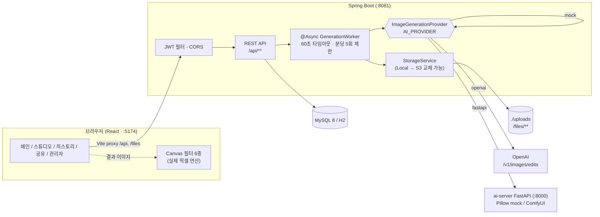
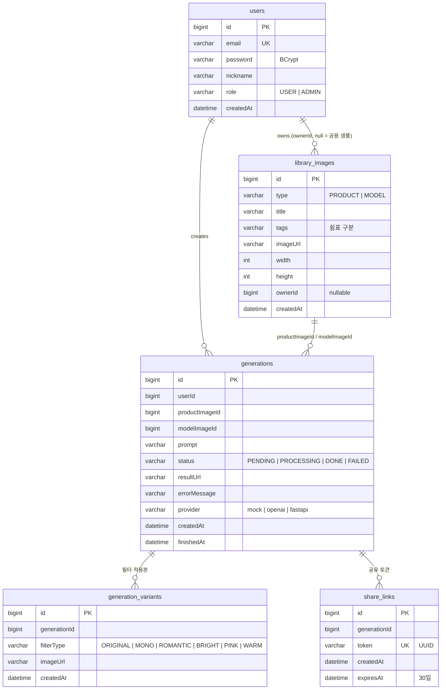

# Pixely — 상품 이미지 + 모델 = 광고 컷, 몇 초 만에

쇼핑몰 판매자가 **상품 이미지 1장 + 모델 이미지 1장 + 텍스트 요청사항**을 넣으면, AI가 두 이미지를 합성한 광고용 이미지를 만들어 주는 서비스입니다. 결과물에 분위기 필터 6종을 적용한 뒤 PNG로 다운로드하거나 공개 링크로 공유할 수 있습니다.

- **대상**: 쿠팡, 올리브영, 11번가, G마켓, 컬리 같은 오픈마켓의 판매자
- **해결하려는 문제**: 상품 이미지만으로는 매력이 부족하고, 모델 캐스팅 비용은 부담스러움

| 영역 | 기술 |
|---|---|
| frontend | React 18, Vite 6, React Router 6, Axios, Zustand, Bootstrap 5, AOS, Swiper |
| backend | Spring Boot 3.5 (Java 17), Gradle, Spring Web / Data JPA / Validation / Security + JWT, Lombok |
| DB | MySQL 8 (운영) · H2 파일 DB MySQL 모드 (개발 기본값) |
| ai-server (선택) | Python FastAPI + Pillow (mock), ComfyUI 연결 지점 |

---

## 1. 아키텍처



**생성 흐름**: `POST /api/generations` 호출 → `PENDING` 저장(즉시 커밋) → `@Async` 워커가 `PROCESSING`으로 바꾸고 provider를 호출(별도 executor, 60초 타임아웃) → 결과를 PNG로 정규화해 저장한 뒤 `DONE` (실패하면 `FAILED`와 에러 메시지 저장). 프론트는 1.5초마다 `GET /api/generations/{id}`를 polling합니다.

## 2. ERD



> 라이브러리 이미지가 삭제되어도 생성 기록은 남아야 하므로, 이미지 참조는 FK 없이 ID 컬럼으로 저장합니다. 응답에는 "삭제된 이미지"로 표시됩니다.

## 3. API

모든 응답은 공통 포맷을 씁니다: `{ success, data }` 또는 `{ success:false, code, message, errors[] }` (검증 메시지는 한국어).

| Method | Path | 인증 | 설명 |
|---|---|---|---|
| POST | `/api/auth/signup` | - | 회원가입 → JWT 발급 |
| POST | `/api/auth/login` | - | 로그인 → JWT 발급 |
| GET | `/api/auth/me` | USER | 내 정보 |
| GET | `/api/library?type=PRODUCT\|MODEL&q=&page=&size=` | 선택 | 공용 샘플 + (로그인 시) 내가 올린 이미지 |
| POST | `/api/library` (multipart `file`, `type`, `title?`, `tags?`) | USER | 내 이미지 업로드 (jpg/png/webp, 10MB, 긴 변 1600px로 리사이즈) |
| DELETE | `/api/library/{id}` | USER | 내 이미지 삭제 |
| POST | `/api/generations` `{productImageId, modelImageId, prompt}` | USER | 비동기 생성 시작 → `generationId` (202) |
| GET | `/api/generations/{id}` | USER | 상태 polling |
| GET | `/api/generations?page=&size=` | USER | 내 생성 히스토리 |
| POST | `/api/generations/{id}/variants` `{filterType, imageBase64}` | USER | 필터 적용본 저장 |
| POST | `/api/generations/{id}/share` | USER | 공유 토큰 발급 (유효한 토큰이 있으면 재사용) |
| GET | `/api/share/{token}` | - | 비로그인 공개 조회 |
| GET/POST/DELETE | `/api/admin/library` | ADMIN | 공용 샘플 관리 |
| GET | `/api/admin/generations?status=&page=` | ADMIN | 전체 생성 내역 |
| GET | `/api/health` | - | 상태 확인 + 현재 AI provider |
| GET | `/files/**` | - | 업로드/결과 파일 서빙 |

## 4. 실행 방법 (Windows PowerShell)

### 사전 요구사항
- **JDK 17 이상**: 이 PC에는 `java`가 PATH에 없고 IntelliJ가 받은 `~/.jdks/temurin-24.0.2`가 있습니다. 아래처럼 현재 세션에만 지정하면 됩니다. JDK가 없다면 [Temurin 17](https://adoptium.net/)을 설치하세요. (빌드는 `options.release = 17`이라 어떤 JDK 17+ 버전이든 Java 17 바이트코드로 컴파일됩니다.)
- Node.js 18 이상 (확인 버전: v24)
- (선택) Python 3.10 이상: ai-server 실행용
- (선택) Docker Desktop: MySQL 컨테이너용

### 1) 환경변수
```powershell
# 루트에서 (이미 .env 가 있으면 생략)
Copy-Item .env.example .env
# JWT_SECRET 을 랜덤값으로 생성해서 .env 에 넣으려면:
$b = New-Object byte[] 48; [Security.Cryptography.RandomNumberGenerator]::Create().GetBytes($b); [Convert]::ToBase64String($b)
```

### 2) 백엔드 (포트 8081)
```powershell
cd backend
$env:JAVA_HOME = "$env:USERPROFILE\.jdks\temurin-24.0.2"   # 설치된 JDK 경로로 바꾸세요
$env:Path = "$env:JAVA_HOME\bin;$env:Path"
.\gradlew.bat bootRun
```
처음 실행하면 다음이 자동으로 처리됩니다.
- 관리자 계정 `admin@pixely.com` 생성 (비밀번호는 `.env`의 `ADMIN_PASSWORD`)
- 공용 샘플 시드: `_legacy/service-images/tab1`(상품)과 `tab2`(모델)가 있으면 그 이미지를 쓰고, 없으면 코드로 그린 상품 8장과 **가상 모델** 8장을 생성 (실존 인물이 아니라 초상권 문제 없음)
- H2 DB 파일 `backend/data/`, 업로드 폴더 `backend/uploads/`

### 3) 프론트엔드 (포트 5174)
```powershell
cd frontend
npm install
npm run dev
# → http://localhost:5174  (/api, /files 는 Vite 프록시로 8081 에 전달)
```

### 4) (선택) ai-server (포트 8000)
```powershell
cd ai-server
python -m venv .venv
.\.venv\Scripts\python.exe -m pip install -r requirements.txt
.\.venv\Scripts\python.exe main.py
```

### 테스트 / 빌드
```powershell
cd backend;  .\gradlew.bat build      # 통합 11 + mock 3 + 원격 provider(스텁 서버) 4 = 18개 테스트 (H2 test 프로필)
cd frontend; npm run lint; npm run build
```

## 5. 환경변수 (`.env`)

| 키 | 기본값 | 설명 |
|---|---|---|
| `SERVER_PORT` | 8081 | 백엔드 포트 (8080이 이미 사용 중이라 변경) |
| `FRONTEND_PORT` | 5174 | Vite 포트 (5173이 이미 사용 중이라 변경) |
| `AI_SERVER_PORT` | 8000 | ai-server 포트 |
| `DB_URL` / `DB_USERNAME` / `DB_PASSWORD` | H2 파일 DB | JDBC 접속 정보 (URL로 H2/MySQL 자동 판별) |
| `MYSQL_PORT` / `MYSQL_DATABASE` / `MYSQL_USER` / `MYSQL_PASSWORD` / `MYSQL_ROOT_PASSWORD` | 3307 / pixely … | docker-compose MySQL 설정 |
| `JWT_SECRET` | (필수) | 32바이트 이상 랜덤 문자열 |
| `JWT_EXPIRATION_MINUTES` | 1440 | 토큰 만료 시간 (분) |
| `ADMIN_EMAIL` / `ADMIN_PASSWORD` | admin@pixely.com / (필수) | 관리자 계정 시드 |
| `CORS_ALLOWED_ORIGINS` | http://localhost:5174,… | 허용 Origin (쉼표 구분) |
| `PUBLIC_BASE_URL` | http://localhost:5174 | 공유 링크 앞부분 |
| `UPLOAD_DIR` | ./uploads | 로컬 파일 저장 위치 (backend 기준) |
| `LEGACY_IMAGES_DIR` | ../_legacy/service-images | 샘플 시드 원본 폴더 |
| `AI_PROVIDER` | mock | `mock` · `openai` · `fastapi` |
| `AI_TIMEOUT_SECONDS` | 60 | 생성 타임아웃 |
| `GENERATION_RATE_LIMIT_PER_MINUTE` | 5 | 사용자별 분당 생성 횟수 |
| `MOCK_DELAY_MIN_MS` / `MOCK_DELAY_MAX_MS` | 2000 / 4000 | mock 지연 (로딩 UX 확인용) |
| `OPENAI_API_KEY` / `OPENAI_IMAGE_MODEL` / `OPENAI_BASE_URL` | (빈 값) / gpt-image-1 / https://api.openai.com/v1 | OpenAI provider 설정 |
| `FASTAPI_URL` | http://localhost:8000 | ai-server 주소 |
| `AI_ENGINE` (ai-server) | mock | `mock` · `comfyui` |
| `COMFYUI_URL` / `COMFYUI_WORKFLOW` (ai-server) | - | ComfyUI 주소, API 포맷 워크플로우 JSON 경로 |

비밀값은 모두 `.env`에서 읽고, `.env`는 `.gitignore`에 들어 있습니다. OS 환경변수가 `.env`보다 우선합니다.

## 6. AI provider 전환

| provider | 설정 | 동작 |
|---|---|---|
| **mock** (기본) | `AI_PROVIDER=mock` | API 키 없이도 끝까지 동작합니다. Java Graphics2D로 모델 이미지 위에 상품을 배치하고 알파 실루엣 기반 소프트 섀도를 넣은 뒤, 요청사항 키워드(밝게·따뜻·흑백·선명·핑크 등)에 맞춰 톤을 보정합니다. 2~4초 지연이 있으며, 결과에 "MOCK PREVIEW" 워터마크가 찍힙니다. |
| **openai** | `AI_PROVIDER=openai`<br/>`OPENAI_API_KEY=sk-...`<br/>`OPENAI_IMAGE_MODEL=gpt-image-1` | `POST /v1/images/edits`에 이미지 2장(`image[]`)과 프롬프트를 보냅니다. 한국어 요청사항은 "모델이 상품을 자연스럽게 들고/사용하는 광고 사진"이라는 영어 지시문으로 감싸서 전달합니다 (`PromptBuilder`). |
| **fastapi** | `AI_PROVIDER=fastapi`<br/>`FASTAPI_URL=http://localhost:8000` | ai-server의 `POST /generate`(multipart)로 위임합니다. ai-server는 기본적으로 Pillow mock 합성을 쓰고, `AI_ENGINE=comfyui`로 바꾸면 ComfyUI에 워크플로우를 제출합니다 (`{{PRODUCT_IMAGE}}`, `{{MODEL_IMAGE}}`, `{{PROMPT}}` 치환). |

`.env`를 고친 뒤 백엔드를 재시작하면 적용됩니다. 현재 provider는 `GET /api/health`로 확인할 수 있습니다.

## 7. MySQL로 전환

이 PC에서는 로컬 MySQL80이 3306에서 실행 중이고 Docker는 설치되어 있지 않습니다. root 비밀번호를 알 수 없어서 개발 기본 DB는 H2 파일 DB(MySQL 모드)로 두었습니다.

**A. 로컬 MySQL(3306) 사용**
```powershell
# 1) db/init.sql 의 'change-me' 를 원하는 비밀번호로 바꾼 뒤 root 로 실행
Get-Content db\init.sql | & "C:\Program Files\MySQL\MySQL Server 8.0\bin\mysql.exe" -uroot -p
# 2) .env 수정
#   DB_URL=jdbc:mysql://localhost:3306/pixely?useSSL=false&allowPublicKeyRetrieval=true&serverTimezone=Asia/Seoul&characterEncoding=UTF-8
#   DB_USERNAME=pixely
#   DB_PASSWORD=<1에서 정한 비밀번호>
```

**B. Docker MySQL(호스트 3307) 사용**
```powershell
docker compose --env-file .env up -d
# .env: DB_URL=jdbc:mysql://localhost:3307/pixely?...  DB_USERNAME=pixely  DB_PASSWORD=<MYSQL_PASSWORD>
```
테이블은 JPA `ddl-auto=update`가 자동으로 생성합니다.

## 8. 화면

| 경로 | 화면 |
|---|---|
| `/` | 메인(기업 소개): 히어로, 문제 정의, 3단계 사용법, 타겟 플랫폼 텍스트 뱃지, 숫자 카운터, 비포/애프터 Swiper(공용 샘플을 브라우저에서 합성), FAQ, CTA, 푸터 |
| `/studio` | 3단 스튜디오. 좌: 탭, 디바운스 검색, 무한 스크롤, 드래그 스크롤, 업로드 / 중: 결과, 웨이브 로딩, 필터 6종 / 우: 슬롯 2개, 요청사항, 예시 칩, 생성. 태블릿 이하에서는 1→2→3 세로 단계형으로 바뀝니다. |
| `/history` | 내 생성 기록 그리드 → 상세 모달(필터 버전) → "스튜디오에서 다시 편집" |
| `/share/:token` | 비로그인 공개 결과 페이지 |
| `/login`, `/signup` | 인증 |
| `/admin` | 공용 샘플 업로드·삭제, 전체 생성 내역 표(상태 필터, 페이지네이션) |

## 9. 기존 시안(service.html) 대비 개선점

| 기존 문제 | 개선 |
|---|---|
| `generateImage` 함수 중복 정의 | 생성 로직을 `StudioPage.handleGenerate` 하나로 통합하고, 서버 비동기 작업 + polling으로 처리 |
| `openTab`이 전역 `event`에 의존 | 상태 기반 `Tabs` 컴포넌트 (role=tablist, ←/→ 키보드 이동) |
| 드래그 스크롤이 첫 번째 그리드에만 붙음 | `useDragScroll(ref)` 훅을 컨테이너마다 적용 (라이브러리 그리드, 필터 스트립). 드래그 후 클릭 오작동도 방지 |
| 필터가 GIF를 바꿔 끼우는 가짜 동작 | Canvas로 실제 픽셀에 적용 (흑백 / 로맨틱=핑크 톤+블러 글로우 / 화사하게=밝기·채도 업 / 핑크빛 / 따뜻하게). 다운로드하면 현재 필터가 적용된 PNG가 받아지고, 필터 버전은 서버에도 저장 |
| 공유 버튼 미구현 | 공유 토큰(30일) 발급 → 클립보드 복사 토스트, 모바일은 `navigator.share`, 클립보드가 막히면 링크 모달 |
| Swiper를 로드만 하고 사용하지 않음 | 메인 비포/애프터 슬라이더에서 실제로 사용 (tiny-slider 제거, Swiper로 통일) |
| 결과가 실제 AI 출력이 아님 | `ImageGenerationProvider` 추상화: mock / OpenAI / FastAPI(ComfyUI) |
| alert/confirm 사용 | 커스텀 Modal(포커스 트랩, ESC) / Toast / ConfirmHost |
| 픽셀 고정값(width:600px, max-height:680px) | CSS grid + `minmax`, `clamp()`, aspect-ratio 기반 유동 레이아웃. 1440/1024/768/390 대응 |
| 하드코딩 색상 | `styles/tokens.css` 디자인 토큰 (색, 4px 간격, radius, 그림자, 폰트 스케일) |
| 빈/로딩/에러 상태 없음 | EmptyState, Skeleton(shimmer), ErrorState(다시 시도) 전 화면 적용 |
| 접근성 부족 | aria-label, `:focus-visible` 링, alt 텍스트, skip link, aria-live 상태 안내, reduced-motion 대응 |

## 10. 폴더 구조

```
pixely/
├─ backend/            Spring Boot (com.pixely.{domain/user,library,generation,share | ai | global | seed})
├─ frontend/           React + Vite (pages, components/{common,layout,studio,home}, hooks, store, lib, styles)
├─ ai-server/          FastAPI (main.py, compose.py=Pillow mock, comfyui.py)
├─ db/init.sql         MySQL DB/계정 생성
├─ docker-compose.yml  MySQL 8 (utf8mb4, 호스트 3307)
├─ _legacy/            원본 보관 (이번 작업 시점에는 비어 있었음)
├─ PROGRESS.md / DECISIONS.md
└─ .env.example
```

## 11. Git

```powershell
git remote -v                 # origin https://github.com/kimkkkkj/pixely.git
git push -u origin main       # 인증이 필요하면 GitHub 로그인 / PAT 사용
```
